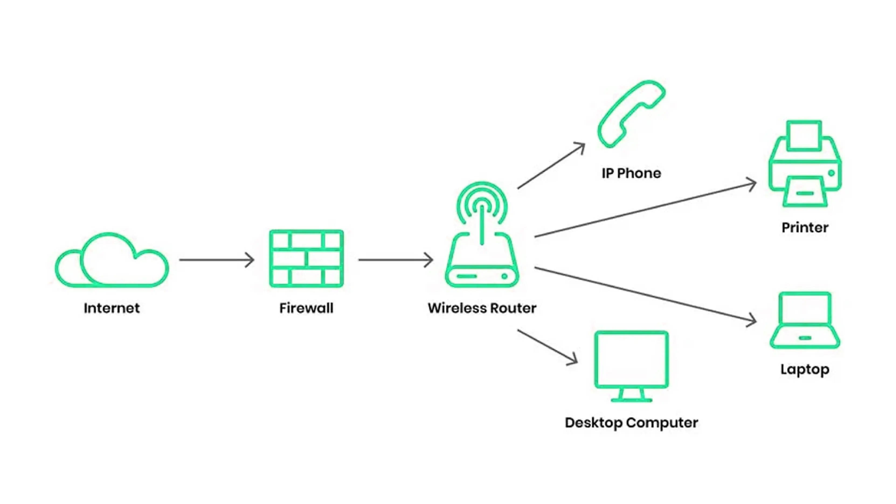
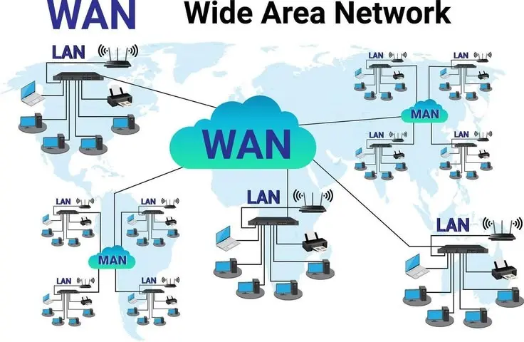
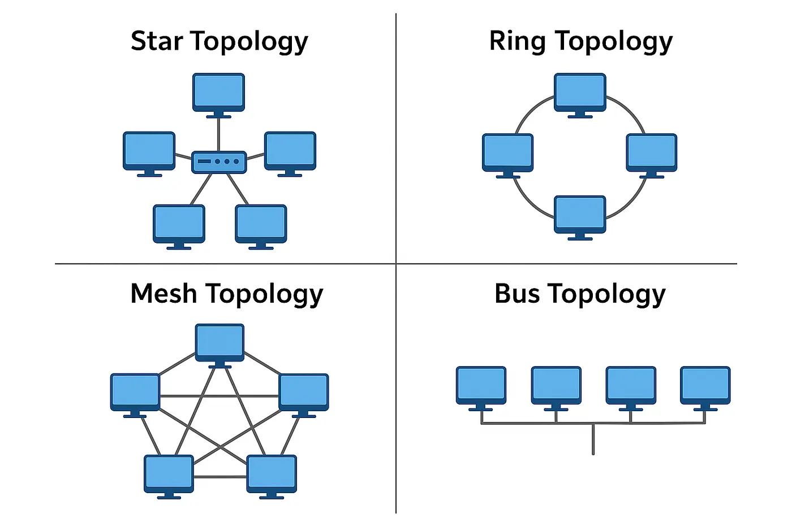
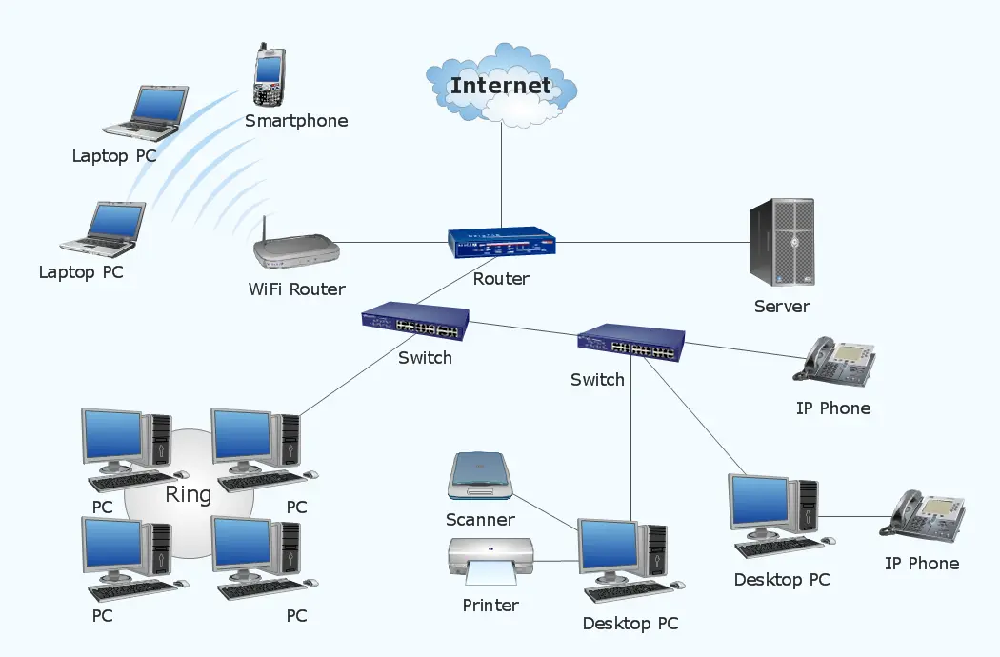

# What is Computer Networking?

Computer Networking ဆိုတာ Computer, Server, Smartphone, Printer နဲ့ အခြား Network Devices တွေကို ချိတ်ဆက်ပြီး Data နဲ့ Resources တွေကို အပြန်အလှန် ပေးပို့အသုံးပြုနိုင်အောင် ပြုလုပ်ထားတဲ့ စနစ်ဖြစ်ပါတယ်။

ဥပမာအားဖြင့် ရုံးတစ်ရုံးမှာ Computer အများအပြားကို Network ချိတ်ဆက်ထားခြင်းကြောင့် File တွေမျှဝေနိုင်တယ်၊ Printer တစ်လုံးကို အများအပြားအသုံးပြုနိုင်တယ်၊ Internet ကိုလည်း အတူတကွ အသုံးပြုနိုင်ပါတယ်။

Computer Networking ဟာ ယနေ့ခေတ် Internet, Cloud Computing, Data Centers, CCTV Systems နဲ့ Fiber Optic Communication တို့အတွက် အရေးကြီးတဲ့ အခြေခံနည်းပညာတစ်ခု ဖြစ်ပါတယ်။

*ပုံ ၁ — Computer Networking ၏ အခြေခံဖွဲ့စည်းပုံ*

## 1. How Does a Computer Network Work?

Network တစ်ခုအတွင်း Data ပေးပို့တဲ့အခါ အောက်ပါလုပ်ငန်းစဉ်တွေ ပါဝင်နိုင်ပါတယ်။

1. **Sender:** Data ပေးပို့မယ့် Computer သို့မဟုတ် Device။
2. **Network Device:** Switch, Router နဲ့ Access Point တို့က Data ပေးပို့မှုကို သက်ဆိုင်ရာ Network အတွင်း စီမံပေးတယ်။
3. **Transmission Medium:** Copper Cable, Fiber Optic Cable သို့မဟုတ် Wireless Signal တို့က Data သယ်ဆောင်ပေးတယ်။
4. **Receiver:** Data ကို လက်ခံမယ့် Device။

ဥပမာ Computer A က Computer B ဆီ File တစ်ခု ပို့တဲ့အခါ Data ကို Network Protocol တွေနဲ့ စီမံပြီး သင့်လျော်တဲ့ Network Path ကတစ်ဆင့် ပေးပို့ပါတယ်။

## 2. Types of Computer Networks

Network တွေကို လွှမ်းခြုံထားတဲ့ ပထဝီဝင်အကျယ်အဝန်းနဲ့ အသုံးပြုပုံအပေါ် မူတည်ပြီး အမျိုးအစားခွဲနိုင်ပါတယ်။

*ပုံ ၂ — LAN, MAN နှင့် WAN Network အမျိုးအစားများ*

| Network Type | Full Form | အသုံးပြုပုံ |
|---|---|---|
| LAN | Local Area Network | အိမ်၊ ရုံး၊ အဆောက်အအုံအတွင်း Network ချိတ်ဆက်ခြင်း |
| MAN | Metropolitan Area Network | မြို့တစ်မြို့ သို့မဟုတ် မြို့ပြဧရိယာအတွင်း Network ချိတ်ဆက်ခြင်း |
| WAN | Wide Area Network | မြို့များ၊ နိုင်ငံများ သို့မဟုတ် အကွာအဝေးကြီးမားသော နေရာများကို ချိတ်ဆက်ခြင်း |

### LAN — Local Area Network

LAN ကို အိမ်၊ ရုံး၊ ကျောင်းနဲ့ စက်ရုံတွေမှာ အသုံးများပါတယ်။ Ethernet Cable နဲ့ Wi-Fi တို့ကို အသုံးပြုပြီး Devices တွေကို ချိတ်ဆက်နိုင်ပါတယ်။

### MAN — Metropolitan Area Network

MAN ဟာ မြို့ပြဧရိယာအတွင်းရှိ ရုံးခွဲများ၊ အဖွဲ့အစည်းများနဲ့ Network Locations များကို ချိတ်ဆက်ရာမှာ အသုံးဝင်ပါတယ်။ Fiber Optic Infrastructure ကို အသုံးပြုနိုင်ပါတယ်။

### WAN — Wide Area Network

WAN ဟာ အကွာအဝေးကြီးမားတဲ့ နေရာတွေကို ချိတ်ဆက်ပေးပါတယ်။ Internet ဟာ WAN နည်းပညာများစွာနဲ့ Network များကို အပြန်အလှန် ချိတ်ဆက်ထားတဲ့ ကမ္ဘာလုံးဆိုင်ရာ စနစ်တစ်ခု ဖြစ်ပါတယ်။

## 3. Network Topology

Network Topology ဆိုတာ Network Devices တွေကို ဘယ်လိုပုံစံနဲ့ ချိတ်ဆက်ထားသလဲဆိုတာကို ဖော်ပြတဲ့ ဖွဲ့စည်းပုံဖြစ်ပါတယ်။

*ပုံ ၃ — Network Topology ပုံစံများ*

အသုံးများတဲ့ Topology ပုံစံတွေမှာ အောက်ပါတို့ ပါဝင်ပါတယ်။

- **Star Topology:** Devices တွေကို Central Switch သို့မဟုတ် Hub တစ်ခုဆီ ချိတ်ဆက်ထားတယ်။ ယနေ့ခေတ် Ethernet LAN တွေမှာ အသုံးများတယ်။
- **Bus Topology:** Devices တွေကို Main Communication Line တစ်ခုတည်းနဲ့ ချိတ်ဆက်ထားတဲ့ ပုံစံဖြစ်တယ်။
- **Ring Topology:** Devices တွေကို စက်ဝိုင်းပုံစံ ချိတ်ဆက်ထားတယ်။
- **Mesh Topology:** Devices သို့မဟုတ် Network Nodes တွေကြားမှာ လမ်းကြောင်းအများအပြား ရှိနိုင်တယ်။ Redundancy နဲ့ Reliability အတွက် အသုံးဝင်တယ်။

Topology တစ်ခုချင်းစီမှာ Cost, Scalability, Performance နဲ့ Fault Tolerance တို့အပေါ် မူတည်ပြီး အားသာချက်၊ အားနည်းချက်တွေ ရှိပါတယ်။

## 4. Basic Network Architecture

Network တစ်ခုမှာ End Devices, Network Devices နဲ့ Transmission Media တို့ အဓိကပါဝင်ပါတယ်။

*ပုံ ၄ — Basic Network Architecture*

### End Devices

Network ကို အသုံးပြုတဲ့ Devices တွေဖြစ်ပါတယ်။

- Desktop Computer
- Laptop
- Server
- Smartphone
- Network Printer
- IP Camera

### Switch

Switch ဟာ Local Area Network အတွင်းရှိ Devices တွေကို ချိတ်ဆက်ပေးပါတယ်။ ပုံမှန် Ethernet Switch တစ်ခုဟာ Ethernet Frame တွေကို MAC Address အပေါ်မူတည်ပြီး သက်ဆိုင်ရာ Port ဆီ Forward လုပ်ပေးပါတယ်။

### Router

Router ဟာ မတူညီတဲ့ IP Networks တွေအကြား Data Packet တွေကို ပို့ဆောင်ပေးပါတယ်။ Home Router တစ်ခုမှာ Routing အပြင် Wi-Fi နဲ့ အခြားလုပ်ဆောင်ချက်တွေလည်း ပါဝင်နိုင်ပါတယ်။

### Access Point

Access Point (AP) ဟာ Wireless Devices တွေကို Network တစ်ခုနဲ့ ချိတ်ဆက်ပေးပါတယ်။

### Transmission Media

Data ကို ပို့ဆောင်ရာမှာ အသုံးပြုတဲ့ ကြားခံပစ္စည်းတွေ ဖြစ်ပါတယ်။

- **Copper Cable:** Ethernet Network တွေမှာ အသုံးများတယ်။
- **Fiber Optic Cable:** အလင်းကို အသုံးပြုပြီး Data ပို့ဆောင်တယ်။
- **Wireless:** Radio Frequency Signal တွေကို အသုံးပြုတယ်။

## 5. How Data Travels Through a Network

ဥပမာ Computer တစ်လုံးက Internet Website တစ်ခုကို ဝင်ကြည့်တဲ့အခါ ပုံမှန်အားဖြင့် အောက်ပါအဆင့်တွေ ပါဝင်နိုင်ပါတယ်။

1. User က Browser ထဲမှာ Website Address ကို ရိုက်ထည့်တယ်။
2. DNS က Domain Name နဲ့ သက်ဆိုင်တဲ့ IP Address ကို ရှာဖွေပေးတယ်။
3. Computer က Data Packet တွေကို Network ကတစ်ဆင့် ပေးပို့တယ်။
4. Router တွေက Packet တွေကို သင့်လျော်တဲ့ Network Path အတိုင်း Forward လုပ်ပေးတယ်။
5. Server က Request ကို လက်ခံပြီး Response ပြန်ပို့တယ်။
6. Browser က လက်ခံရရှိတဲ့ Data ကို အသုံးပြုပြီး Website ကို ဖော်ပြတယ်။

အမှန်တကယ် Network Communication မှာ DNS Cache, Routing, TCP သို့မဟုတ် QUIC, TLS နဲ့ အခြား Protocol တွေလည်း ပါဝင်နိုင်ပါတယ်။

## 6. IP Address and MAC Address

IP Address နဲ့ MAC Address တို့ဟာ Network Communication မှာ အရေးကြီးတဲ့ Address အမျိုးအစားနှစ်ခု ဖြစ်ပါတယ်။

| Feature | IP Address | MAC Address |
|---|---|---|
| အဓိကအသုံးပြုမှု | IP Network အတွင်း Routing | Local Network အတွင်း Frame Delivery |
| အမျိုးအစား | IPv4, IPv6 | ပုံမှန် Ethernet Interface များတွင် 48-bit Address |
| အသုံးပြုသည့် Layer | Network Layer | Data Link Layer |

IP Address ဟာ Network တစ်ခုအတွင်း သို့မဟုတ် Network များအကြား Data ပို့ဆောင်ရာမှာ အသုံးပြုပါတယ်။ MAC Address ကတော့ Ethernet လို Data Link Technology တွေမှာ Local Link အတွင်း Frame ပို့ဆောင်ဖို့ အသုံးပြုပါတယ်။

## 7. Client-Server and Peer-to-Peer Networks

### Client-Server Network

Client Devices တွေက Server ဆီက Service သို့မဟုတ် Data ကို Request လုပ်ပြီး ရယူတဲ့ ပုံစံဖြစ်ပါတယ်။

ဥပမာ — Website Hosting, Email Services နဲ့ File Servers။

### Peer-to-Peer (P2P) Network

Devices တွေက Central Server တစ်ခုတည်းအပေါ် အပြည့်အဝ မမှီခိုဘဲ တစ်ခုနဲ့တစ်ခု Resources တွေကို တိုက်ရိုက်မျှဝေနိုင်တဲ့ ပုံစံဖြစ်ပါတယ်။

အသုံးပြုမယ့် Network ရဲ့ ရည်ရွယ်ချက်၊ Security နဲ့ Management Requirements တွေအပေါ် မူတည်ပြီး Architecture ကို ရွေးချယ်ရပါတယ်။

## 8. The Relationship Between Computer Networking and Fiber Optics

Computer Networking နဲ့ Fiber Optic Technology တို့ဟာ အလွန်နီးကပ်စွာ ဆက်စပ်နေပါတယ်။

Computer Networking က Data ကို ဘယ်လို Address လုပ်မလဲ၊ ဘယ်လို Forward လုပ်မလဲ၊ ဘယ်လို Protocol တွေ အသုံးပြုမလဲဆိုတာကို စီမံပေးပါတယ်။ Fiber Optic Technology ကတော့ Data ကို အလင်း Signal အဖြစ် Optical Fiber အတွင်း သယ်ဆောင်ပေးနိုင်ပါတယ်။

Fiber Optic Cable တွေရဲ့ အားသာချက်တွေကတော့ -

- **High Bandwidth:** Data ပမာဏများစွာကို သယ်ဆောင်နိုင်တယ်။
- **Long-Distance Transmission:** အကွာအဝေးကြီးမားတဲ့ နေရာတွေကို ချိတ်ဆက်နိုင်တယ်။
- **Low Attenuation:** သင့်လျော်တဲ့ Fiber နဲ့ System Design ကို အသုံးပြုရင် အကွာအဝေးရှည် Transmission အတွက် သင့်တော်တယ်။
- **Electromagnetic Interference Resistance:** Electrical Noise ကြောင့် သက်ရောက်မှုရှိနိုင်တဲ့ ပတ်ဝန်းကျင်တွေမှာ အားသာချက်ရှိတယ်။

Fiber Optic Cable တွေကို ISP Backbone Networks, Data Centers, FTTH (Fiber to the Home), Enterprise Networks နဲ့ Submarine Cable Systems တွေမှာ အသုံးပြုကြပါတယ်။

Fiber Optic Technician တစ်ယောက်အတွက် Computer Networking Fundamentals ကို နားလည်ထားခြင်းဟာ Switch, Router, SFP Module, Optical Transceiver နဲ့ Network Troubleshooting တို့ကို ပိုမိုနားလည်စေပါတယ်။

## 9. Advantages and Limitations of Computer Networking

### Advantages

- Devices တွေအကြား File နဲ့ Resource Sharing ပြုလုပ်နိုင်တယ်။
- Centralized Data Management ကို အသုံးပြုနိုင်တယ်။
- Communication နဲ့ Collaboration ပိုမိုလွယ်ကူစေတယ်။
- Internet နဲ့ Cloud Services တွေကို အသုံးပြုနိုင်တယ်။
- Network Monitoring နဲ့ Security Policies တွေကို စီမံနိုင်တယ်။

### Limitations

- Network Infrastructure တည်ဆောက်ဖို့ ကုန်ကျစရိတ်ရှိတယ်။
- Configuration မှားယွင်းမှုကြောင့် Communication ပြတ်တောက်နိုင်တယ်။
- Security အားနည်းရင် Unauthorized Access နဲ့ Data Loss ဖြစ်နိုင်တယ်။
- Network တစ်ခုလုံးကို အနှောင့်အယှက်ဖြစ်စေမယ့် Single Point of Failure ရှိနိုင်တယ်။
- ပုံမှန် Monitoring, Maintenance နဲ့ Troubleshooting လိုအပ်တယ်။

## Conclusion

Computer Networking ဟာ ယနေ့ခေတ် Digital Communication ရဲ့ အခြေခံဖြစ်ပါတယ်။ LAN, MAN, WAN, Network Topology, Switch, Router နဲ့ IP Address တို့ကို နားလည်ထားခြင်းက ပိုမိုအဆင့်မြင့်တဲ့ Networking နဲ့ Fiber Optic Technology တွေကို ဆက်လက်လေ့လာရာမှာ အထောက်အကူပြုပါတယ်။

Fiber Optic နည်းပညာကို လေ့လာနေသူတွေအတွက် Networking Fundamentals ဟာ Fiber Optic Infrastructure ကို နားလည်ဖို့နဲ့ Network Fault တွေကို မှန်ကန်စွာ Troubleshoot လုပ်နိုင်ဖို့ အရေးကြီးတဲ့ အခြေခံတစ်ခု ဖြစ်ပါတယ်။