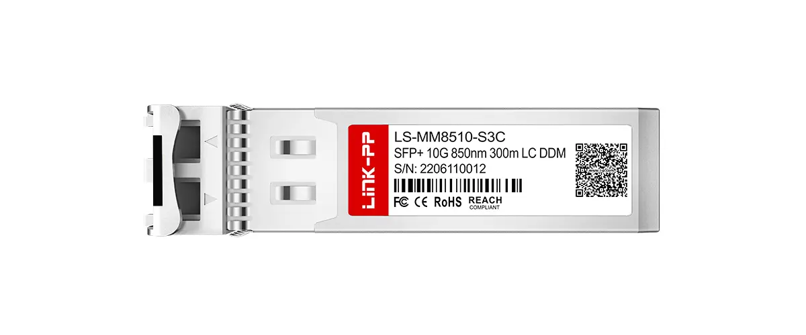
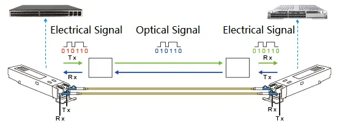
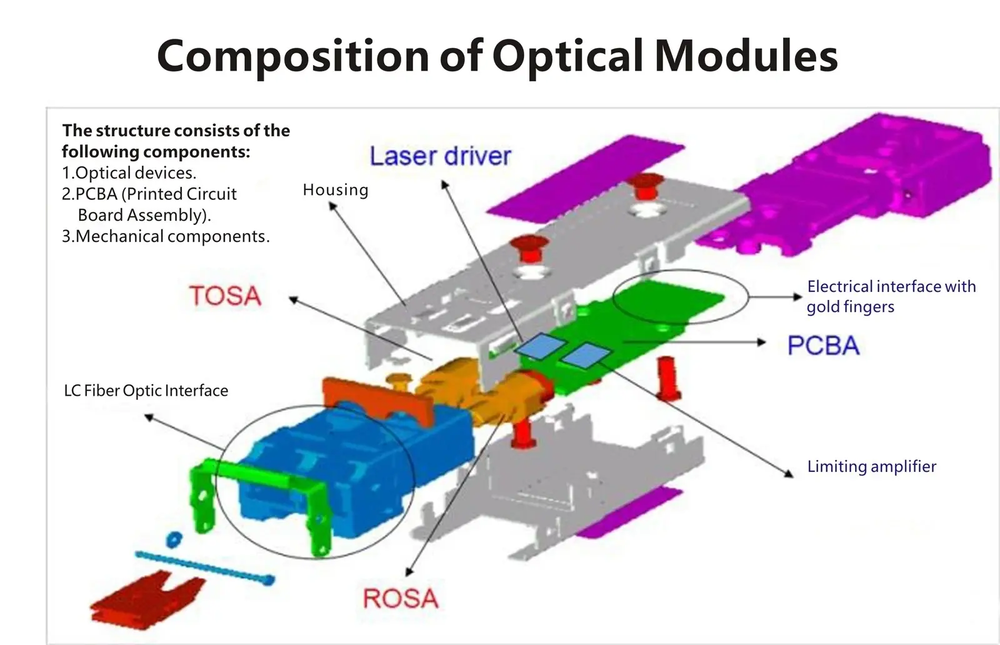
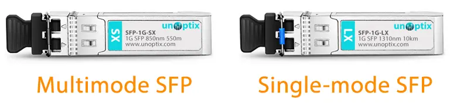
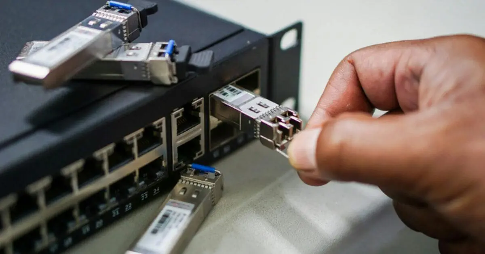

## 1. Introduction

Network Switch၊ Router နှင့် Media Converter ကဲ့သို့ ကိရိယာများတွင် Fiber Optic ကို ချိတ်ဆက်ရန် ပုံမှန်အားဖြင့် **SFP** ကို အသုံးပြုသည်။ SFP သည် လက်ဖဝါးထဲဆန့်လောက်သည့် အသေးစား Module တစ်ခုဖြစ်သော်လည်း Device ထဲမှ Electrical Signal ကို Fiber ပေါ်သွားနိုင်သော Light Signal အဖြစ် ပြောင်းပေးသည့် အရေးကြီးသော အလုပ်ကို လုပ်ဆောင်သည်။

ဤဆောင်းပါးတွင် SFP ဆိုသည်မှာ ဘာလဲ၊ ဘယ်လိုအလုပ်လုပ်သလဲ၊ အမျိုးအစားများ ဘယ်လိုကွာခြားသလဲနှင့် လက်တွေ့တပ်ဆင်ရာတွင် သတိထားရမည့်အချက်များကို အဆင့်လိုက် ရှင်းပြမည်။

## 2. Definition

**SFP** ၏ အပြည့်အစုံမှာ **Small Form-factor Pluggable** ဖြစ်သည်။ အဓိကအချက်များမှာ —

- **Transceiver:** Transmitter (TX) နှင့် Receiver (RX) တို့ကို Module တစ်ခုတည်းတွင် ပေါင်းထားသည်။
- **Pluggable:** Device ၏ SFP Port ထဲသို့ ထည့်ပြီး ပြန်ထုတ်နိုင်သည်။ Hot-pluggable ဖြစ်သောကြောင့် Device ကို ပိတ်စရာမလိုဘဲ အစားထိုးနိုင်သည်ဟု ယေဘုယျအားဖြင့် ဆိုနိုင်သည်။
- **Small Form-factor:** အရွယ်အစားသေးငယ်သဖြင့် Switch တစ်လုံးတွင် Port အရေအတွက်များများ ထည့်နိုင်သည်။

SFP ကို Module အဖြစ် ခွဲထားခြင်းကြောင့် Switch ကို မလဲဘဲ Fiber အမျိုးအစား၊ Wavelength နှင့် အကွာအဝေးကို လိုအပ်သလို ရွေးချယ်နိုင်သည်။

> မှတ်ချက် — SFP အမျိုးအစားများကို Multi-Source Agreement (MSA) ဟုခေါ်သော ထုတ်လုပ်သူများ သဘောတူစံနှုန်းများအရ ထုတ်လုပ်ကြသည်။ ထုတ်လုပ်သူအလိုက် Specification ကွာနိုင်သဖြင့် Datasheet ကို အမြဲစစ်ပါ။

## 3. How It Works

### 3.1 Transmit (TX)

1. Switch ထဲမှ **Electrical Signal** သည် SFP ၏ Electrical Connector မှတစ်ဆင့် Module ထဲဝင်သည်။
2. Module ထဲရှိ Driver Circuit က Signal ကို Laser သို့ ပို့သည်။
3. **Laser** သည် Electrical Signal အတိုင်း Light Signal အဖြစ် ပြောင်းလဲထုတ်လွှင့်သည်။
4. Light Signal သည် Fiber ၏ Core ထဲသို့ ဝင်ပြီး Fiber လမ်းကြောင်းအတိုင်း သွားသည်။

### 3.2 Receive (RX)

1. Fiber မှ ဝင်လာသော Light Signal ကို **Photodiode** က လက်ခံသည်။
2. Photodiode က Light Signal ကို အားနည်းသော Electrical Signal အဖြစ် ပြန်ပြောင်းသည်။
3. Amplifier နှင့် အခြား Circuit များက Signal ကို ပြင်ဆင်ပြီး Switch သို့ ပြန်ပို့သည်။

### 3.3 Duplex Connection

SFP အများစုသည် **LC Duplex** Connector ကို သုံးသည်။ Fiber နှစ်ချောင်း (တစ်ချောင်း TX အတွက်၊ တစ်ချောင်း RX အတွက်) ရှိသည်။ ချိတ်ဆက်ရာတွင် တစ်ဖက်၏ **TX သည် တစ်ဖက်၏ RX နှင့်** ချိတ်ရမည်ဖြစ်သည်။ ဤချိတ်ဆက်မှု ပြောင်းပြန်ဖြစ်နေလျှင် Link မတက်နိုင်ပါ။

## 4. Components or Important Factors

### 4.1 အတွင်းပိုင်း အစိတ်အပိုင်းများ

| အစိတ်အပိုင်း | လုပ်ဆောင်ချက် |
|---|---|
| **TOSA** (Transmitter Optical Sub-Assembly) | Laser ပါဝင်ပြီး Electrical Signal ကို Light Signal အဖြစ် ပြောင်းသည် |
| **ROSA** (Receiver Optical Sub-Assembly) | Photodiode ပါဝင်ပြီး Light Signal ကို Electrical Signal အဖြစ် ပြန်ပြောင်းသည် |
| **PCB** | Control နှင့် Signal Processing Circuit များ တပ်ဆင်ထားသည် |
| **Housing** | Module ကို ကာကွယ်ပေးပြီး Port ထဲတွင် တည်ငြိမ်စေသည် |
| **Bail Latch** | Module ကို Port ထဲတွင် ကျစ်ကျစ်လျစ်လျစ်ထားပြီး ထုတ်ရာတွင် အသုံးပြုသည် |
| **Optical Interface (LC)** | Patch Cord ချိတ်ဆက်သည့်နေရာ |
| **Electrical Edge Connector** | Switch ၏ SFP Port နှင့် ချိတ်ဆက်သည့် Contact များ |

### 4.2 Singlemode နှင့် Multimode SFP

| အချက် | Multimode SFP | Singlemode SFP |
|---|---|---|
| အသုံးပြုသော Fiber | Multimode Fiber (ဥပမာ 50/125 µm) | Singlemode Fiber (9/125 µm) |
| ပုံမှန် Wavelength | 850 nm | 1310 nm သို့မဟုတ် 1550 nm |
| အကွာအဝေး | အတိုမှ အလတ် (Building သို့မဟုတ် Campus အတွင်း) | အလတ်မှ အဝေး (Kilometer ပေါင်းများစွာ) |

ဥပမာအနေဖြင့် Gigabit Ethernet တွင် 1000BASE-SX (850 nm၊ Multimode) သည် Fiber အမျိုးအစားပေါ်မူတည်၍ ၂၂၀ m မှ ၅၅၀ m အထိ၊ 1000BASE-LX10 (1310 nm၊ Singlemode) သည် ၁၀ km အထိ အသုံးပြုနိုင်ရန် IEEE 802.3 တွင် သတ်မှတ်ထားသည်။ ထို့ထက်ပိုဝေးသော ထုတ်ကုန်များ (ဥပမာ 1550 nm အသုံးပြုသော Long-reach Module) သည် ထုတ်လုပ်သူ Specification ပေါ်မူတည်သည်။

> အရေးကြီး — SFP အမျိုးအစားနှင့် Fiber အမျိုးအစား ကိုက်ညီရမည်။ ၎င်းအပြင် Link တစ်ခု၏ နှစ်ဖက်စလုံးရှိ SFP များသည် Speed၊ Wavelength နှင့် စံနှုန်း တူညီရမည်။

### 4.3 SFP Family

| အမျိုးအစား | ပုံမှန် Speed |
|---|---|
| SFP | 1 Gbps (Gigabit Ethernet) အထိ |
| SFP+ | 10 Gbps |
| SFP28 | 25 Gbps |

Form Factor ပုံစံတူသော်လည်း Speed မတူသောကြောင့် Switch Port က ထောက်ပံ့သော Speed ကို စစ်ဆေးပြီးမှ ဝယ်ယူရမည်။

### 4.4 BiDi SFP

**BiDi (Bidirectional) SFP** သည် Fiber တစ်ချောင်းတည်းပေါ်တွင် TX နှင့် RX အတွက် Wavelength နှစ်မျိုးကွဲကို အသုံးပြုသည်။ BiDi Module များကို Wavelength တွဲများအတိုင်း (ဥပမာ တစ်ဖက်တွင် 1310 nm TX၊ တစ်ဖက်တွင် 1550 nm TX) ထုတ်လုပ်သဖြင့် Link တစ်ခု၏ နှစ်ဖက်တွင် တွဲဖက်ကိုက်ညီသော Module များကို သုံးရမည်။

## 5. Technical Explanation

### 5.1 Digital Diagnostics Monitoring (DDM/DOM)

SFP အများအပြားတွင် Module ၏ အခြေအနေကို Switch မှ ဖတ်နိုင်သော DDM (သို့မဟုတ် DOM) လုပ်ဆောင်ချက် ပါဝင်သည်။ ပုံမှန်အားဖြင့် အောက်ပါတန်ဖိုးများကို ကြည့်နိုင်သည် —

- Module Temperature
- Supply Voltage
- TX Bias Current
- TX Optical Power (dBm)
- RX Optical Power (dBm)

ဤတန်ဖိုးများသည် Link troubleshooting လုပ်ရာတွင် အသုံးဝင်သည်။ ဥပမာ RX Power အလွန်နိမ့်နေလျှင် Fiber Loss များခြင်း၊ Connector ညစ်ပေခြင်း သို့မဟုတ် Fiber ကွေးခြင်းကဲ့သို့ ပြဿနာများကို သံသယရှိနိုင်သည်။ DDM ထောက်ပံ့မှုသည် Module နှင့် Device အပေါ်မူတည်သည်။

### 5.2 Optical Power Specifications

SFP Datasheet တွင် Optical Power နှင့်ဆိုင်သော အောက်ပါတန်ဖိုးများကို ကြည့်ရမည်။ Optical Power ကို ပုံမှန်အားဖြင့် **dBm** (1 mW နှင့် နှိုင်းယှဉ်သော Power Level) ဖြင့် ဖော်ပြသည်။

| Specification | အဓိပ္ပာယ် |
|---|---|
| **TX Power** | SFP မှ Fiber ထဲသို့ ထုတ်လွှတ်သော Optical Power |
| **RX Sensitivity** | Receiver လက်ခံနိုင်သော အနိမ့်ဆုံး Optical Power |
| **RX Overload** | Receiver လက်ခံနိုင်သော အမြင့်ဆုံး Optical Power |

Link တစ်ခု အလုပ်လုပ်ရန် RX သို့ ရောက်သော Light Signal ၏ Power သည် RX Sensitivity နှင့် RX Overload ကြားတွင် ရှိရမည်။

- **နိမ့်လွန်းလျှင်:** Fiber Loss၊ Connector Loss၊ Splice Loss များပြီး Signal အားနည်း၍ Link မတည်ငြိမ်ခြင်း သို့မဟုတ် မတက်ခြင်း ဖြစ်နိုင်သည်။
- **မြင့်လွန်းလျှင်:** အကွာအဝေးတိုပြီး TX Power မြင့်သော Module ကို သုံးပါက Receiver Overload ဖြစ်နိုင်သည်။ ထိုသို့ဖြစ်လျှင် Datasheet ကိုစစ်ပြီး သင့်လျော်သော Module ရွေးခြင်း သို့မဟုတ် Optical Attenuator သုံးခြင်းတို့ကို စဉ်းစားရမည်။

Fiber Loss နှင့် Connector Loss များကို ထည့်သွင်းစဉ်းစားပြီး Link တစ်ခုလုံး၏ Power လုံလောက်မှုကို တွက်ချက်ခြင်းကို **Link Budget** ဟုခေါ်သည်။ Link Budget ကို သီးခြားဆောင်းပါးတွင် အသေးစိတ်ရှင်းပြမည်ဖြစ်သည်။

<!-- Link Budget Article ရှိလာလျှင် အထက်ပိုဒ်၏ နောက်တွင် Internal Link ကို ဤနေရာတွင် ထည့်ပါ -->

## 6. Practical Applications

- Switch များကြား Uplink ချိတ်ဆက်ခြင်း
- Building တစ်ခုနှင့် တစ်ခုကြား Backbone Link
- Data Center အတွင်း Server နှင့် Switch ချိတ်ဆက်ခြင်း
- FTTH Network ၏ Aggregation နှင့် OLT ဘက်ရှိ Uplink များ
- Router နှင့် Media Converter များတွင် Fiber Port တပ်ဆင်ခြင်း

### 6.1 Switch တွင် တပ်ဆင်ပုံ

1. Switch ၏ SFP Port နှင့် Module ၏ Speed၊ အမျိုးအစား ကိုက်ညီမှုကို စစ်ပါ။
2. SFP ကို Port ထဲသို့ ကလစ်ကနဲ ကျသည်အထိ ဖြည်းညင်းစွာ တွန်းထည့်ပါ။
3. Optical Port ၏ Dust Cap ကို ဖယ်ပါ။
4. Connector ကို သန့်ရှင်းကြောင်း စစ်ပြီးမှ LC Duplex Patch Cord ကို ချိတ်ပါ။
5. တစ်ဖက်၏ TX သည် တစ်ဖက်၏ RX နှင့် ချိတ်ကြောင်း သေချာပါစေ။
6. Port LED နှင့် Switch ၏ Interface Status ကို စစ်ပါ။

> Safety Warning — SFP Laser များမှ ထွက်သော Light သည် မျက်လုံးနှင့် မမြင်ရသော Infrared ဖြစ်နိုင်ပြီး မျက်လုံးကို ထိခိုက်စေနိုင်သည်။ Module သို့မဟုတ် Fiber အဆုံးကို မျက်လုံးနှင့် တိုက်ရိုက် မကြည့်ပါနှင့်။ မသုံးသည့်အခါ Dust Cap ပြန်ဖုံးပါ။

## 7. Common Mistakes

- **Fiber အမျိုးအစား မကိုက်ခြင်း:** Singlemode SFP ကို Multimode Fiber နှင့် (သို့မဟုတ် ပြောင်းပြန်) သုံးခြင်း။
- **Wavelength မကိုက်ခြင်း:** Link နှစ်ဖက်တွင် မတူသော Wavelength/စံနှုန်း Module သုံးခြင်း။ BiDi ကို တွဲဖက်မကိုက်ဘဲ သုံးခြင်း။
- **TX/RX ပြောင်းပြန်ချိတ်ခြင်း:** Patch Cord ၏ Polarity မှားခြင်း။
- **Connector မသန့်ရှင်းခြင်း:** ဖုန်မှုန့်သည် Loss များစေရန် အဖြစ်များသော အကြောင်းရင်းတစ်ခုဖြစ်သည်။
- **Fiber ကို အလွန်ကွေးခြင်း:** Bend Loss ဖြစ်စေသည်။
- **Speed ကို မစစ်ခြင်း:** SFP နှင့် SFP+ တို့ ပုံစံတူသော်လည်း Speed မတူပါ။
- **RX Overload ကို မစဉ်းစားခြင်း:** အကွာအဝေးတိုသော Link တွင် TX Power မြင့်သော Module ကို Datasheet မစစ်ဘဲ သုံးခြင်း။
- **Compatibility ကို မစစ်ခြင်း:** ထုတ်လုပ်သူအချို့၏ Device များသည် Module ကို Compatibility စစ်ဆေးနိုင်သဖြင့် Device ၏ Documentation ကို ကြည့်ပါ။
- **DDM ကို မကြည့်ခြင်း:** ရရှိနိုင်သော Diagnostic အချက်အလက်ကို အသုံးမချခြင်း။

## 8. Key Takeaways

- SFP သည် Electrical Signal နှင့် Light Signal ကို အပြန်အလှန်ပြောင်းပေးသော Hot-pluggable Transceiver Module ဖြစ်သည်။
- အတွင်းတွင် TOSA (Laser) နှင့် ROSA (Photodiode) တို့ ပါဝင်သည်။
- Singlemode နှင့် Multimode SFP သည် Fiber၊ Wavelength နှင့် အကွာအဝေး ကွာခြားသဖြင့် ကိုက်ညီအောင် ရွေးရမည်။
- Link တစ်ခု၏ နှစ်ဖက်စလုံးတွင် Speed၊ Wavelength နှင့် စံနှုန်း ကိုက်ညီရမည်။
- TX Power၊ RX Sensitivity နှင့် RX Overload ကို Datasheet တွင် စစ်ပြီး RX သို့ ရောက်သော Power သည် ထိုနှစ်ခုကြားတွင် ရှိရမည်။
- Laser Safety နှင့် Connector သန့်ရှင်းမှုကို အမြဲ ဂရုစိုက်ပါ။